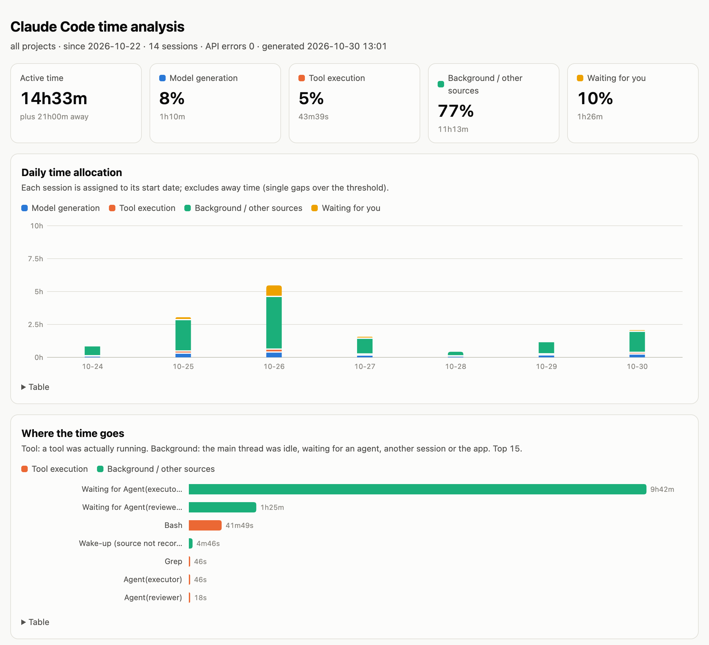
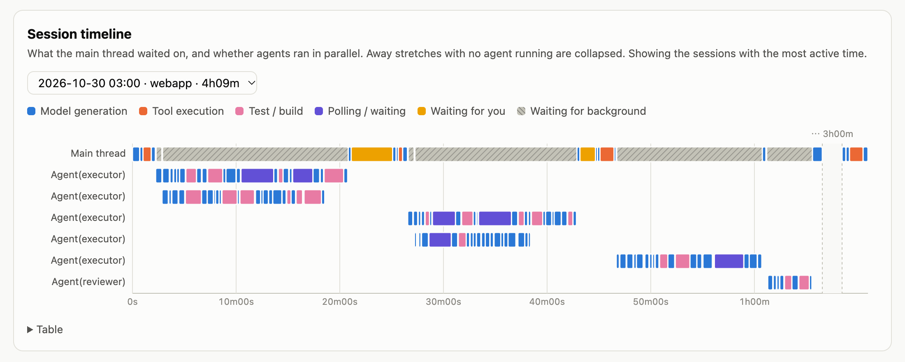

# cc-timeline

[](https://github.com/tomclassless/cc-timeline/actions/workflows/ci.yml)
[](https://pypi.org/project/cc-timeline/)
[](https://pypi.org/project/cc-timeline/)
[](LICENSE)

[English](README.md)

你的 Claude Code session 時間花到哪去了？`cc-timeline` 讀 Claude Code 本來就存在你電腦上的逐字稿，把 session 的每一秒歸到 **模型**、**工具**、**背景等待**（subagent、其他 session、App）、**等你**或**離開**。也能往 subagent 裡面看，各類 agent 的時間花在思考、寫程式碼、讀取、測試還是輪詢。

**我自己一週的發現。** 在我自己一週的工作（40 個 session）裡，Claude Code 主 session 有 **51%** 的活躍時間在等 subagent。reviewer 花的時間跟寫程式的 executor 差不多（各約 8 小時），而 executor 內部只有 12% 的時間在寫程式碼：31% 在思考、19% 在跑測試、13% 在 sleep 輪詢迴圈。

*以下截圖使用合成的示範資料。*





## 相關工具

- [ccusage](https://github.com/ccusage/ccusage)：token 用量與費用報表。
- [claude-devtools](https://github.com/matt1398/claude-devtools)：session 重建與 context 拆解。
- [claude-session-dashboard](https://github.com/dlupiak/claude-session-dashboard)：儀表板，含 agent 派工甘特圖。
- [claude-code-log](https://github.com/daaain/claude-code-log) 與 [claude-code-transcripts](https://github.com/simonw/claude-code-transcripts)：把逐字稿轉成 HTML。
- [sniffly](https://github.com/chiphuyen/sniffly)：使用統計與錯誤分析。
- [claude-session-analyzer](https://github.com/yonk-labs/claude-session-analyzer)：逐回合時間與 skill 分析。
- [官方 OpenTelemetry monitoring](https://code.claude.com/docs/en/monitoring-usage)：即時匯出指標與事件，需事先啟用。

`cc-timeline` 只專注一個問題：回溯分析磁碟上既有的逐字稿，把「模型在工作」和「什麼都沒發生、在等某個東西」分開，並推算背景等待屬於哪一種 agent。

## 安裝

需要 Python 3.9 以上，只用標準函式庫。

```bash
# 不安裝，直接跑（PyPI 發佈後可用）
uvx cc-timeline

# 或從 git repo 執行（現在就能用）
uvx --from git+https://github.com/tomclassless/cc-timeline cc-timeline

# 安裝成工具
uv tool install git+https://github.com/tomclassless/cc-timeline   # 或：uv tool install cc-timeline
pip install git+https://github.com/tomclassless/cc-timeline       # 或：pip install cc-timeline
```

也可以用 `python -m cc_timeline`。

### 在 Claude Code 裡使用（plugin）

這個 repo 同時是 Claude Code 的 plugin marketplace：

```
/plugin marketplace add tomclassless/cc-timeline
/plugin install cc-timeline@cc-timeline
/cc-timeline:timeline --days 14
```

`timeline` skill 會帶著你給的參數執行 `cc-timeline --html --open`，並摘要結果。目前它透過 `uvx --from git+https://github.com/tomclassless/cc-timeline` 從 git repo 執行；套件上 PyPI 之後可改成單純的 `uvx cc-timeline`。

## 用法

```bash
cc-timeline                                  # 最近 7 天，每個 session 一行
cc-timeline --days 30 --project myapp        # 依專案資料夾名稱過濾
cc-timeline --since 2026-03-01 --until 2026-03-31   # 依開始日期篩選（本地時區，含當日）
cc-timeline --by week                        # 依日／週／專案／session 彙總，每組一列
cc-timeline --csv sessions.csv               # session 明細輸出成 CSV（搭配 --by 則輸出彙總列）
cc-timeline --session 3f2a                   # 單一 session：分項與最慢的步驟
cc-timeline --session 3f2a --trace 3         # 最慢 3 步前後的事件類型（不含內容）
cc-timeline --agents                         # 依 agent 類型看 subagent 內部
cc-timeline --html                           # ./cc-timeline-report.html
cc-timeline --html out.html --open           # 寫出並用瀏覽器打開
cc-timeline --json | jq .totals              # 輸出報表資料給腳本處理
cc-timeline --html --timeline-sessions 5     # 只為最忙的 5 個 session 嵌入甘特圖（預設 20，0 = 不嵌）
cc-timeline --html --redact                  # 要貼截圖時用：專案名、session id、自訂 agent 與 MCP 名匿名化
cc-timeline --lang zh-TW                     # 或設 CC_TIMELINE_LANG=zh-TW
```

逐字稿讀自 `$CLAUDE_CONFIG_DIR/projects`，沒設就是 `~/.claude/projects`（可用 `--root` 指定）。其他選項：`--idle-cap 分鐘`（預設 30）、`--top N`（預設 10）。

日期篩選：`--since`／`--until`（`YYYY-MM-DD`，本地時區，`--until` 含當日）依 session 的**第一筆時間戳**篩選；檔案修改時間只用來快速跳過太舊的檔案。`--days N` 等同 `--since` 設為 N 天前，給了 `--since` 就忽略 `--days`。`--session` 不套日期篩選。

`--by day|week|project|session` 每組印一列：session 數、活躍時間（模型＋工具＋背景）、模型／工具／背景／等你的時間與占比、離開。週採 ISO 週（`2026-W44`）。`--csv PATH` 輸出逐 session 表（欄位 `start, project, session, wall, model, tool, bg, user, idle, errors, top`，秒數為數字）；搭配 `--by` 時輸出彙總列。

## Session 時間軸（HTML）

報表有一張「Session 時間軸」卡片：一次看一個 session 的甘特圖（下拉選擇，預設是背景等待占比最高的那個）。第一列是主對話，其後每個 subagent 一列，可以看出主對話在等什麼、agent 有沒有平行執行。

- 顏色對應時間類別：模型＝藍、工具＝橘、測試／建置＝粉紅、輪詢等待＝紫、等你＝黃、等背景＝灰色斜線。主對話與 agent 同語意同色（agent 的思考／寫程式碼／其他生成算「模型」；讀取／腳本／git／其他工具算「工具」）。
- 超過 `--idle-cap` 的離開空檔，若當時沒有 agent 在跑，會壓縮成固定寬度的斷軸，標示如 `⋯ 3h12m`。
- subagent 超過 15 個時，同類型且時間不重疊的 agent 合併到同一列。
- 為了控制報表大小，只嵌入活躍時間最長的 `--timeline-sessions N` 個 session（預設 20，`0` 表示不顯示這張卡片）。「表格」區列出每個 agent 的類型、開始、結束與時長。

## 時間怎麼歸類

兩個事件之間的空檔，算給**下一個有意義的事件**。

| 類別 | 空檔的意思 |
| --- | --- |
| 模型 | 等模型生成回覆 |
| 工具 | 工具執行中（直到結果回來） |
| 背景 | 主對話閒著：在等 subagent、其他 session／agent、App（`sdk`）或被喚醒。對得到的會標出 agent 類型 |
| 等你 | 等使用者的回合（`turnOrigin: human`），或 `AskUserQuestion`、`ExitPlanMode`、`request_directory` 的回答 |
| 離開 | 單一空檔超過 `--idle-cap`（睡眠、午休、隔天 resume），不算進其他類 |

細節：

- 附屬事件（`queue-operation`、`api-request`、`attachment`、`system`、`file-history-snapshot`、`progress` 等）不切斷時間，空檔留給下一個真正的事件。
- 兩則不同 message id 的 assistant 訊息之間沒有 user 訊息或工具結果，代表 session 被喚醒。空檔在最後一個附屬事件處切開：之前算背景，之後算模型。
- 背景等待用 `origin.from` 或 `<task-id>` 對回啟動它的 Agent／Task 呼叫；對不到標「未對應」。
- subagent 逐字稿（`<session>/subagents/agent-*.jsonl`）依下一個區塊分類：thinking 區塊前是思考，Edit／Write 呼叫前是寫程式碼，其他 assistant 輸出是其他生成；工具時間分成讀取、測試／建置、輪詢、腳本、git、安裝、其他。非 tool_result 的 user 訊息會重設計時。
- Bash 指令用啟發式分類：含 `sleep` 是輪詢；含 test／build／lint 等字是測試；`npm install` 之類是安裝；否則看第一個指令（git、讀取類、腳本、其他）。

## 格式變動警告

Claude Code 的逐字稿格式沒有公開文件（`turnOrigin`、`queue-operation`、`api-request` 等都是觀察得來，不是規格）。掃描時 `cc-timeline` 會統計各 entry 的 `type`、`turnOrigin`／`origin.kind` 的值，以及每筆 entry 的 Claude Code `version`。遇到不認得的 type 或 origin 時，會在 CLI 結尾以 stderr 印一行警告（只輸出 `--json` 時不印；`--html` 仍會印），HTML 頁尾也會顯示，代表 Claude Code 格式很可能改了，數字可能不準，請帶著顯示的名稱開 issue。`--json` 有 `format` 區塊（`types`、`origins`、`versions`、`unknown`），HTML 頁尾會顯示看到的 Claude Code 版本範圍。未知的 origin 仍歸入背景，標為「其他來源（x）」。

## 限制

- 逐字稿格式不是公開 API，可能會變；部分歸類依賴實際觀察到的欄位。
- 平行的 subagent 會重疊，各 agent 時間加總可能大於主對話實際等待的時間。
- 權限確認其實是在等你，但記錄上算在工具時間。
- Bash 分類是依指令文字的啟發式判斷。
- 終端機輸出的欄位對齊假設字元寬度一致，中文會有些歪。

## MCP server

`cc-timeline mcp` 會啟動一個 MCP server（stdio，只用標準函式庫），讓 Claude 查詢自己的時間分配。加進 Claude Code：

```bash
claude mcp add cc-timeline -- uvx --from git+https://github.com/tomclassless/cc-timeline cc-timeline mcp
```

（套件上 PyPI 後可簡化成 `claude mcp add cc-timeline -- uvx cc-timeline mcp`。）安裝 plugin 時會自動註冊同一個 server。Claude Desktop 則在 `claude_desktop_config.json` 加：

```json
{
  "mcpServers": {
    "cc-timeline": {
      "command": "uvx",
      "args": ["--from", "git+https://github.com/tomclassless/cc-timeline", "cc-timeline", "mcp"]
    }
  }
}
```

逐字稿不在 `~/.claude/projects` 時用 `cc-timeline mcp --root PATH`。工具（都接受 `redact: true`，會遮蔽專案名、session id、自訂 agent 名）：

- `summary`：模型／工具／背景／等你的時間占比、前幾名項目、session 與 API 錯誤數；可用 `by` 依日、週、專案或 session 分列。
- `agent_phases`：各 agent 類型的次數、平均時長，以及思考、寫碼、測試、輪詢、讀取的占比。
- `session_timeline`：單一 session（id 前綴，或 `"current"` 代表 server 工作目錄最近的 session）：時間分配、最慢 10 步、各 subagent 的 phase。
- `compare`：兩段日期並列比較與差值（after − before），樣本不足時附註。
- `quality_signals`：各 agent 的回報÷派出、測試失敗率、API 錯誤、每個 session 派出 executor 次數、sleep 輪詢占比。

沒有 MCP 時，命令列也拿得到同樣資料：`cc-timeline compare --before 2026-10-01:2026-10-14 --after 2026-10-15:2026-10-28 [--project X] [--json]`、`cc-timeline quality [--days N | --since D --until D] [--json]`。

**隱私：**工具只回傳彙總數字、名稱與 id，絕不回傳對話文字、assistant 輸出或 Bash 指令文字；測試用一個特徵字串驗證這點。

## 自我調校（`/cc-timeline:tune`）

`tune` skill 請 Claude 比較最近 N 天（預設 7）與前 N 天，找出前三大時間消耗，對照已知模式（agent 思考太久、每次都跑完整測試、sleep 輪詢、reviewer 一直退件、agent 工作時主對話閒置）。每個建議都附具體修改（哪個檔、哪幾行）、預期效果，以及多久後再比較。

```
/cc-timeline:tune --days 7
/cc-timeline:tune --days 14 --project myapp
```

它**只提出建議，不會修改**你的設定、agent 定義或 CLAUDE.md。每個建議都附品質護欄，因為時間下降可能是壞事：調整後若回報÷派出、測試失敗率或 API 錯誤上升，就不算改善，只是把成本移到別處。累積足夠的 session（每期至少 5 個）後再跑一次 `/cc-timeline:tune`，確認調整是否站得住腳。

## 隱私

全部在本機執行，不會送出任何東西。只用到時間戳、事件類型、工具名稱與 id，不會輸出對話內容。Bash 指令文字只用來分類，不會輸出。`--trace` 只輸出事件類型：以 `<` 開頭的 user 訊息只顯示標籤名（例如 `<task-notification`），自由文字的 `reason` 欄位除非是單純識別字，否則會被遮住。

要分享截圖、報表、JSON 或 CSV 前，請用 `--redact`。它會取代：

- 專案名 → `project-1`、`project-2`…
- session id → 短雜湊
- 自訂 agent 類型（`general-purpose`、`Explore`、`Plan`、`statusline-setup`、`claude-code-guide` 以外的）→ `agent-1`、`agent-2`…
- MCP server 名 → `mcp-1`、`mcp-2`…（server 後面的工具名保留）

效果涵蓋表格、`--by`、`--agents`、`--trace`、HTML、JSON、CSV。它**不會**遮：內建 agent 類型、一般工具名（`Read`、`Bash` 等）、MCP 工具名、時間戳與時長、API 錯誤次數、Claude Code 版本，以及你自己印出來的 `--root` 路徑。

## 開發

```bash
uv venv && uv pip install -e . pytest && .venv/bin/python -m pytest -q
```

`docs/` 裡的截圖來自合成資料：`python scripts/make_demo.py /tmp/demo --now 2026-10-30T12:00:00Z`，再執行 `cc-timeline --root /tmp/demo --since 2026-10-22 --html report.html`（時間軸用 `--session 05bde598`），以 headless Chrome 寬 1100px、2 倍解析度截圖（英文介面）。

## 授權

MIT
